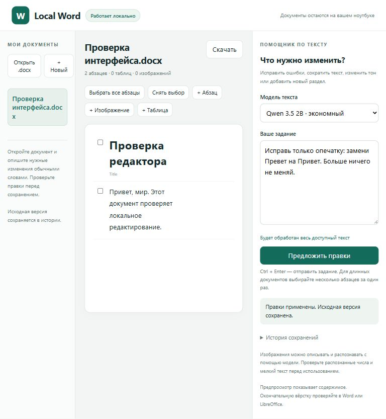

# MCP Word

Локальный редактор файлов Microsoft Word `.docx` с удобным интерфейсом в браузере, MCP-сервером и моделями Ollama. Приложение исправляет и переписывает текст, работает с таблицами, вставляет и заменяет изображения, описывает картинки и распознаёт видимый на них текст. Microsoft Word не требуется для этих операций.

Основной сценарий — ноутбук **Windows 11 x64, 16 ГБ RAM, Intel Iris Xe**. Вычисления настроены на CPU. Все компоненты приложения сохраняются в одной папке **MCP Word**, без установки Python и Ollama в систему. После подготовки папка работает без интернета и переносится на другой ноутбук Windows x64.



## Быстрая установка с GitHub

1. Откройте [репозиторий](https://github.com/egorantip/MCP-Word).
2. В разделе **Releases** скачайте `MCP-Word-setup.zip`. Если готового релиза ещё нет, выберите **Code → Download ZIP**.
3. Распакуйте архив полностью. Если это архив исходников GitHub, переименуйте полученную папку `MCP-Word-main` в **MCP Word**.
4. Поместите папку в доступное для записи место. Например, **`C:\MCP Word`**, `D:\MCP Word` или на рабочий стол. Папка может находиться рядом с `Program Files`; в `Program Files` ей потребовались бы дополнительные права записи.
5. Дважды щёлкните **`Start.vbs`**. Альтернатива — `Start.bat`.
6. Если компонентов нет, появится запрос на скачивание. Нажмите **Yes**, чтобы разрешить загрузку Python, библиотек, отдельной Ollama и трёх моделей. При отказе ничего не скачивается.
7. Дождитесь завершения подготовки. Ход установки виден в небольшом окне запуска. Затем редактор откроется в вашем обычном браузере.

На первом запуске нужен интернет. Модели занимают суммарно примерно **10 ГБ** по каталогу Ollama; архив Ollama — ещё примерно **1,5 ГБ**, распакованные библиотеки также требуют места. Для подготовки желательно иметь **не менее 22 ГБ свободного места**. Размеры и скорость загрузки зависят от версии и подключения. Распакованный официальный пакет Ollama включает библиотеки NVIDIA, хотя на целевом ноутбуке используется CPU.

Всё скачивается из официальных источников: Python.org, PyPI, GitHub Ollama и реестр Ollama. Python проверяется по опубликованной контрольной сумме; архив Ollama и Python-библиотеки — по SHA256, если он опубликован источником. Проверка TLS остаётся включённой. Для недоступных серверов проверки отзыва сертификатов Windows используется `curl --ssl-revoke-best-effort`.

Администраторские права, глобальный Python, глобальная Ollama и консоль для повседневной работы не нужны. Окно **Local Word** управляет сервисами; браузер содержит сам редактор.

## Перенос на другое устройство

1. Закройте окно **Local Word**, чтобы остановить приложение.
2. Скопируйте **всю папку MCP Word**, включая `runtime` и `models`, на другой ноутбук Windows x64.
3. Запустите `Start.vbs` из нового места.

При полной подготовке повторная установка и интернет не нужны. В папке нет виртуального окружения с привязкой к старому пути: встроенный Python использует относительные пути, остальные пути вычисляются от каталога приложения. Документы и история правок также переносятся.

Обычный архив GitHub содержит программу и установщик. Крупные модели установщик автоматически загружает в ту же папку после разрешения. Подготовленная локальная папка уже содержит всё необходимое для офлайн-работы. Подготовка происходит один раз на месте установки; если вы переносите только исходники без `runtime` и `models`, она потребуется снова.

## Какие модели установлены

| Модель | Размер по каталогу на 8 октября 2026 | Назначение |
|---|---:|---|
| [Qwen 3.5 2B](https://ollama.com/library/qwen3.5:2b) | около 3,1 ГБ | Основная экономная модель для правки небольших фрагментов текста |
| [Qwen 3.5 4B](https://ollama.com/library/qwen3.5:4b) | около 4,0 ГБ | Более сложные правки текста; требует больше памяти и времени |
| [Qwen3-VL 4B](https://ollama.com/library/qwen3-vl:4b) | около 3,3 ГБ | Описание изображений и распознавание текста на них |

В поле **Модель текста** по умолчанию используется Qwen 3.5 2B. Для сложной редакторской задачи можно выбрать Qwen 3.5 4B. Кнопка анализа картинки автоматически использует отдельную **Qwen3-VL 4B**. Универсальные Qwen 3.5 тоже поддерживают изображения, но обе ошиблись в надписи на контрольной картинке; поэтому для распознавания выбран специализированный вариант VL. Подбор является инженерной рекомендацией; быстродействие на конкретном процессоре нужно оценить локально. Дисковый размер модели не равен потреблению RAM.

Все три модели хранятся на диске. В память загружается **одна модель за раз**, запросы выполняются последовательно. После ответа она выгружается (`keep_alive=0s`), поэтому следующий запрос может потребовать повторного прогрева. Для 2B ограничен контекст 4096 токенами и вывод 1024 токенами; для обеих 4B — 8192 и 2048. Изображения перед анализом уменьшаются. Приложение не использует Intel Iris Xe как обязательный ускоритель.

Другие профили доступны разработчику: `minimal` — Qwen 3.5 0.8B; `quality` — 9B. Они **не входят в автоматическую загрузку**. Набор автоматически скачиваемых моделей указан в `portable.json`.

## Как пользоваться редактором

### Открыть или создать документ

- Нажмите **Открыть .docx** и выберите файл. Приложение создаёт рабочую копию в своей папке `documents`; выбранный файл снаружи приложения остаётся исходником.
- Для нового файла нажмите **+ Новый**, укажите имя и при необходимости заголовок.
- Выберите документ в списке слева.

В центре показано содержимое документа. Абзацы таблиц и колонтитулов также доступны для правок. Этот экран показывает структуру и текст, а не точную разбивку Word на страницы. Окончательную вёрстку проверяйте в Word или LibreOffice.

Приложение не перезаписывает уже существующий файл при загрузке. Если имя занято, переименуйте загружаемый файл или создайте другую рабочую копию. Закройте документ в Word перед сохранением из приложения, чтобы Word не блокировал файл.

### Попросить модель изменить текст

1. Выберите модель справа.
2. Для большого документа отметьте нужные абзацы флажками. При отсутствии выбора в запрос включается весь доступный текст.
3. Напишите задание в большом поле ввода.
4. Нажмите **Предложить правки** или **Ctrl + Enter**.
5. Дождитесь ответа и проверьте предложенные изменения: старый текст выделен одним цветом, новый — другим.
6. Нажмите **Применить к документу** либо **Отклонить**.

Примеры заданий:

```text
Исправь опечатки и пунктуацию в выбранном абзаце. Сохрани все имена и числа.

Сократи выбранный фрагмент примерно на треть, сохрани смысл и факты.

Сделай текст более официальным и убери повторения.

Добавь после выбранного абзаца краткий вывод из двух предложений.
```

Модель возвращает проверяемые операции, а не запускаемый код. Правки сначала проходят проверку и показываются пользователю. Если текст слишком большой для выбранного профиля, приложение просит выбрать меньше абзацев; оно не обрезает документ молча. Проверка контекста консервативная, поэтому для лёгкого профиля обычно стоит выбирать один короткий фрагмент за запрос.

Перед применением сравнивается SHA256 документа. Если файл изменился после подготовки предложения, приложение отклоняет устаревшие правки. Откройте документ заново и сформируйте новое предложение.

### Изменить текст вручную

Наведите указатель на абзац, нажмите **Изменить**, отредактируйте текст и нажмите **Сохранить**. Для добавления текста используйте **+ Абзац**.

При замене сохраняются существующие стили абзацев и незатронутых текстовых фрагментов. Новый текст получает формат первого заменяемого фрагмента. Если правка пересекает поля, гиперссылки, исправления Word или рисунок внутри текстового фрагмента, приложение сообщает об ограничении вместо удаления специальных элементов.

### Таблицы

Ячейки существующих таблиц доступны как текстовые абзацы. Их можно исправлять вручную или с помощью модели. Для новой таблицы нажмите **+ Таблица**. Разделите столбцы знаком `|`, а строки переносом:

```text
Наименование | Количество
Карандаш | 10
Блокнот | 5
```

### Изображения

- **+ Изображение** добавляет PNG, JPEG или WebP в документ; они сохраняются в локальных `assets`.
- Под картинкой нажмите **Описать / прочитать**, чтобы получить описание, видимый текст и предложенную подпись.
- Нажмите **Добавить подпись**, чтобы сохранить предложенную подпись отдельным абзацем в конце документа.
- **Заменить** позволяет выбрать новую картинку. Существующий размер отображения сохраняется; при отличающихся пропорциях проверьте результат в Word. Если изображение использовано в нескольких местах как один общий ресурс DOCX, заменятся все его использования.

Модели Qwen анализируют картинки и распознают текст, но не генерируют и не рисуют новые изображения. Для добавления/замены выбирается готовый файл. Мелкий текст и числа после распознавания нужно проверять. Векторные EMF/WMF/SVG могут сохраниться в DOCX, однако их анализ и замена в этом прототипе не поддерживаются.

### Сохранение и возврат к предыдущей версии

Каждое применение правок сохраняет `.docx` атомарно и создаёт резервную копию. Сверху справа нажмите **Скачать**, чтобы получить текущий документ в обычную папку загрузок браузера.

В правой панели раскройте **История сохранений** и нажмите **Восстановить** у нужного сохранения. Текущая версия при восстановлении тоже сохраняется в истории. В интерфейсе показываются последние десять версий; полный список доступен через MCP.

После завершения закройте небольшое окно **Local Word** или нажмите **Stop and close**. Это останавливает только сервисы, запущенные приложением. Закрытие вкладки браузера само по себе сервисы не останавливает. Кнопка **Open editor** повторно открывает редактор.

## Что лежит в папке

```text
MCP Word/
  Start.vbs                   запуск без консоли
  Start.bat                   альтернативный запуск
  portable.json               версии, модели и локальные порты
  README.md                   эта инструкция
  word_mcp/                   программа и интерфейс
  scripts/                    подготовка и упаковка
  runtime/
    python/                   встроенный Python
    site-packages/            установленные библиотеки
    ollama/                   отдельная Ollama
    user/                     служебный профиль и ключи Ollama
    wheels/                   библиотеки для переустановки без интернета
    tmp/                      временные файлы приложения
    prepared.json             версии и список установленных моделей
  models/                     локальные веса моделей Ollama
  documents/
    assets/                   загруженные изображения
    .word_mcp/backups/        резервные копии
    .word_mcp/proposals/      предложения правок
  logs/                       журналы установки и запуска
```

Все пути приложения определяются от этой папки. Переменные среды меняются только у запускаемых процессов, без изменения настроек Windows. Отдельная Ollama использует порт **11435**, поэтому не пересекается с обычной Ollama на 11434. Интерфейс доступен только на данном ноутбуке, по адресу **`http://127.0.0.1:8765`**. Браузер и сама Windows могут создавать собственные системные журналы вне папки приложения.

`runtime`, `models`, `documents` и `logs` исключены из Git: личные документы и служебные ключи не публикуются, а модели автоматически загружаются установщиком. Готовую папку с этими каталогами можно копировать целиком для офлайн-переноса.

## Подключение к MCP-клиенту

Сам интерфейс уже использует сервер и Ollama; отдельный MCP-клиент для работы в браузере не нужен. Для другого приложения доступны **stdio** и **Streamable HTTP**.

### Stdio

После подготовки и запуска `Start.vbs` получите готовый конфигурационный файл:

```powershell
powershell -NoProfile -ExecutionPolicy Bypass -File .\scripts\mcp-config.ps1
```

Результат — `mcp-config.local.json` с путями к текущей папке. Перенесите блок `mcpServers` в настройки вашего MCP-клиента. После переноса папки сформируйте конфигурацию снова: внешнему клиенту нужен новый абсолютный путь.

Пример для `C:\MCP Word`:

```json
{
  "mcpServers": {
    "offline-word": {
      "command": "C:/MCP Word/runtime/python/python.exe",
      "args": ["-m", "word_mcp", "server"],
      "env": {
        "WORD_MCP_ROOT": "C:/MCP Word/documents",
        "WORD_MCP_PROFILE": "light",
        "OLLAMA_HOST": "http://127.0.0.1:11435",
        "PYTHONUTF8": "1"
      }
    }
  }
}
```

Клиент запускает MCP-сервер сам. Для инструментов с локальной моделью оставляйте окно `Local Word` открытым: оно управляет отдельной Ollama. Для полностью офлайн-работы сам внешний LLM-клиент также должен использовать локальную модель.

### Streamable HTTP

Пока `Local Word` работает, MCP доступен по **`http://127.0.0.1:8765/mcp/`**. В HTTP-клиенте укажите заголовок `Authorization: Bearer <token>`. Токен находится в `documents/.word_mcp/http-token`, меняется при запуске и предназначен только для локального соединения. Не публикуйте его.

### Инструменты

| Инструмент | Что делает |
|---|---|
| `list_documents` | Список доступных DOCX |
| `read_document` | Текст, таблицы, картинки, ID абзацев и SHA256 версии |
| `create_document` | Новый документ без перезаписи существующего |
| `edit_schema` | Схема допустимых операций |
| `preview_edit` | Проверка операций и предпросмотр |
| `apply_edit` | Применение разрешённых операций с резервной копией |
| `propose_edit` | Генерация предложения через локальную Ollama |
| `apply_proposal` | Применение рассмотренного предложения |
| `analyze_image` | Анализ встроенного изображения |
| `list_backups` | Полная история сохранений |
| `restore_backup` | Восстановление версии |
| `ollama_status` | Модели и параметры профиля |

Все пути документов относительны к `WORD_MCP_ROOT`. Пример: `отчёт.docx` или `проекты/отчёт.docx`. ID абзацев `p0`, `p1` и т. д. действуют только вместе с возвращённой версией. Они включают абзацы ячеек; ID колонтитулов имеют вид `header1:p0` и `footer1:p0`.

Пример детерминированной правки после `read_document`:

```json
{
  "path": "отчёт.docx",
  "revision": "SHA256 из read_document",
  "plan": {
    "summary": "Исправление опечатки",
    "operations": [
      {"op": "replace_text", "target": "p0", "old": "Превет", "new": "Привет", "occurrence": 0}
    ]
  }
}
```

Поддерживаются `replace_text`, `add_paragraph`, `format_paragraph`, `add_table`, `add_picture`, `replace_picture`. Модель в основном сценарии предлагает только текстовые операции; форматирование и изображения можно менять явными MCP-операциями и средствами интерфейса. Сервер не предоставляет исполнение Python, shell или произвольного кода модели.

## Диагностика

| Проблема | Действие |
|---|---|
| Установка не закончилась | Посмотрите `logs/prepare.err.log` и `logs/prepare-status.txt`; проверьте интернет и свободное место; запустите `Start.vbs` снова |
| Ollama или редактор не запустились | Посмотрите `logs/ollama.err.log` и `logs/web.err.log` |
| Окно ошибки запуска закрылось | Текст ошибки сохраняется в `logs/launcher.err.log`; повторите запуск через `Start.vbs` |
| Порт занят | Закройте второе окно Local Word; при необходимости измените `app_port`/`ollama_port` в `portable.json` и перезапустите |
| Модель отсутствует | Закройте приложение и запустите снова; при недостающем манифесте оно предложит подготовку |
| Повреждены библиотеки/модельные файлы | Закройте приложение, уберите `runtime/prepared.json` и повторите подготовку с разрешением на скачивание; `ollama pull` проверяет локальные слои |
| Превышен контекст | Выберите меньше абзацев или 4B; очень длинный одиночный абзац разбейте вручную |
| Ответ обрывается/невалиден | Правки не применяются. Сократите задание или используйте 4B |
| Документ изменился | Повторно выберите его слева и сформируйте новые правки |
| Нет доступа при сохранении | Закройте файл в Word, проверьте права записи в папку MCP Word |
| Установка в защищённой папке | Перенесите в `C:\MCP Word` или другой каталог, доступный для записи |
| `Start.vbs` запрещён политикой организации | Запустите `scripts/start.ps1` через разрешённый вашей организацией PowerShell с параметром `-STA`; графический интерфейс сохранится |
| Сообщение о параллельной правке после сбоя | Закройте все экземпляры, затем уберите соответствующий `.lock` из `documents/.word_mcp/locks` и перезапустите |

Файлы `.doc`, `.docm`, защищённые паролем документы, PDF, изменение текстовых полей, гиперссылок, формул и истории исправлений в этом прототипе не поддерживаются. При обнаружении специальных элементов в редактируемом абзаце операция отклоняется. Действующие изображения, таблицы и незатронутые специальные элементы сохраняются средствами `python-docx`; для сложных документов требуется проверка в Word. Это редактирование файлов, а не управление открытым окном Microsoft Word.

## Разработка и проверка

Ядро написано на Python 3.11+, использует официальный SDK MCP ветки 1.x, `python-docx`, Pillow, Pydantic, HTTPX и Starlette. Переносимый Windows-пакет содержит Python 3.12.10 и Ollama 0.35.1; версии фиксированы в `portable.json`, библиотеки — в `requirements.lock.txt`.

```powershell
python -m venv .venv
.\.venv\Scripts\python.exe -m pip install -e ".[test]"
.\.venv\Scripts\python.exe -m pytest -q
.\.venv\Scripts\python.exe -m word_mcp web
```

Для разработки с уже установленной Ollama используется обычный `http://127.0.0.1:11434`; у переносимого запуска свой адрес 11435. Переменные: `WORD_MCP_ROOT`, `WORD_MCP_PROFILE`, `WORD_MCP_MODEL`, `WORD_MCP_VISION_MODEL`, `OLLAMA_HOST`.

Проверки охватывают транзакции, сохранение рисунков и форматирования, таблицы, колонтитулы, резервные копии, путь файлов, блокировки, отказ от облачных моделей, лимиты контекста, браузерный API и реальный stdio MCP. Дополнительная живая проверка:

```powershell
.\runtime\python\python.exe .\scripts\verify-live.py
```

Она копирует подготовленную папку в новый путь с пробелами и кириллицей, запускает отдельные тестовые сервисы, проверяет обе текстовые модели и модель изображений, DOCX, картинки, stdio/HTTP MCP и переносимость встроенного Python. Результат записывается в `docs/verification.json`. Проверка не использует личные документы; тестовые материалы лежат в `portable-qa`. Для повторной проверки уже созданной копии добавьте `--reuse-copy`. Это проверка переноса на этом компьютере; отдельный физический ноутбук с 16 ГБ RAM в проверке не использовался.

Для создания архива установки:

```powershell
.\runtime\python\python.exe .\scripts\package.py
```

Получится `dist/MCP-Word-setup.zip` с установщиком. `--offline` включает подготовленные программы и модели; личные документы, ключи и журналы не включаются. Для GitHub больших архивов предусмотрено разбиение на части с помощью `--split-mib 1500`.

Релиз установщика создаётся GitHub Actions при отправке тега `v*`. Не загружайте модели в обычную Git-историю; используйте подготовленную папку или файлы релиза.

## Источники и лицензии

Архитектура инструментов изучена по [Office-Word-MCP-Server](https://github.com/GongRzhe/Office-Word-MCP-Server). Этот проект реализован отдельно; код исходного сервера не копировался. Связка локальной модели и MCP адаптирована по предоставленному локальному примеру MCP Solid.

- [Официальный SDK MCP 1.x](https://py.sdk.modelcontextprotocol.io/v1/)
- [Ollama для Windows и standalone CLI](https://docs.ollama.com/windows)
- [Ollama structured outputs](https://docs.ollama.com/capabilities/structured-outputs)
- [Ollama vision](https://docs.ollama.com/capabilities/vision)
- [Отключение Ollama Cloud](https://docs.ollama.com/faq)
- [Python 3.12.10](https://www.python.org/downloads/release/python-31210/)

Код приложения — MIT. Python, Ollama, зависимости и модели имеют собственные лицензии; при распространении готовой папки сохраняйте лицензионные файлы компонентов. Qwen 3.5 и Qwen3-VL опубликованы с Apache 2.0 по страницам моделей. Модели следует оценивать на реальных документах пользователя; текстовые правки всегда доступны для проверки перед применением.
